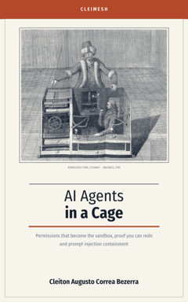

<picture>
  <source media="(prefers-color-scheme: dark)" srcset="docs/assets/banner-dark.png">
  
</picture>

# CleiMesh

[](https://github.com/cleitonaugusto/cleimesh/actions/workflows/ci.yml)
[](#license)
[](https://doi.org/10.5281/zenodo.23547249)

> **Signed permissions for AI agents that the sandbox actually enforces, and receipts anyone can replay to check.**

*[Leia em português](README.pt-BR.md)*


<p align="center">
  <a href="https://leanpub.com/ai-agents-in-a-cage"></a>
  <br>
  <b>Why it is built this way, the attacks it stops, and the mistakes made on the way.</b>
</p>

AI agents (Claude Code, Cursor, LangGraph, CrewAI...) call third-party tools and hand work to other agents, almost always **with all of your permissions**. One malicious tool, or one prompt injection hidden in an email the agent read, can read `~/.ssh` and `.env`, delete files or leak data. Afterwards nobody can prove which agent did what, on whose behalf.

Most tools in this space check permissions **at the door** (a proxy or gateway) and then let the tool run with full access, and their audit logs ask you to trust whoever signed them. CleiMesh puts five pieces together:

1. **Delegable, signed permissions.** You grant an agent a token; it can pass a narrower part to a subagent, offline, and never more than it received. Tokens follow the IETF [Attenuating Agent Tokens](https://datatracker.ietf.org/doc/draft-niyikiza-oauth-attenuating-agent-tokens/) JWT profile.
2. **The permission becomes the sandbox.** Tools run in WebAssembly where **nothing is allowed by default**. The token decides which directories the tool can see, whether it has network, and its limits. A subagent granted `./project/docs` cannot physically read `./project`, even though its parent can.
3. **A signed receipt for every call**, allowed or denied, hash-chained, with a signed log head, verifiable offline, in the format of [draft-sahu-agent-action-receipts](https://datatracker.ietf.org/doc/draft-sahu-agent-action-receipts/). Receipts hold digests and pseudonyms, never the data the call touched. No receipt, no run.
4. **Don't trust the receipt, replay it.** Every call runs with a frozen clock and seeded randomness recorded in its receipt, so an auditor re-runs it and checks the output byte for byte. A node that signs a false result is caught. Only a deterministic sandbox can offer this; a proxy whose tools run natively cannot.
5. **Taint that follows the delegation chain, against prompt injection.** Once a tool that brings in outside content (mail, web) returns to an agent, tools that act on the world refuse that agent's whole chain until a human clears it. The node enforces it, outside the agent: the agent can't forge or erase it, and handing work to a fresh subagent doesn't launder it.

<picture>
  <source media="(prefers-color-scheme: dark)" srcset="docs/assets/how-it-works-dark.png">
  
</picture>

On top: tokens that shrink to what the agent actually used (`audit suggest`), and privacy reports per data subject and per agent (GDPR, Brazil's LGPD), in English or Portuguese.

### Where it fits

<picture>
  <source media="(prefers-color-scheme: dark)" srcset="docs/assets/where-it-fits-dark.png">
  
</picture>

Agent sandboxes such as NVIDIA OpenShell, AWS Strands Box and Anthropic's sandbox-runtime contain **the agent process**: files, system calls and network, by a local policy. CleiMesh works one level down, on **each tool call**: what this tool, called by this agent or subagent, may touch, decided by a signed token that can only narrow as it is delegated, and proved afterwards by a signed receipt anyone can replay. They complement each other: run the agent inside one of those sandboxes to contain what it does outside CleiMesh (its own shell, its other tools), and route the tools that touch your data through CleiMesh.

Inside such a sandbox the node's host usually has a name rather than an IP; `--node` and `--bootstrap` take `/dns4/HOST/tcp/PORT/p2p/PEER_ID`. Step by step with NVIDIA OpenShell, tested: [docs/openshell.md](docs/openshell.md).

| | Agent sandboxes (OpenShell, Strands Box, sandbox-runtime) | CleiMesh |
|---|---|---|
| What is contained | the whole agent process | each tool call |
| Where the permission comes from | a policy file or a central gateway | a signed token the sandbox is built from |
| Subagents | share the agent's policy | get a narrower token, offline, never a wider one |
| Afterwards | decision logs | signed, hash-chained receipts, replayable byte for byte |
| Prompt injection | rules over the session's events (Strands Box) | taint on every holder of the delegation chain, cleared only by a human |

*(As of October 2026; check each project for what it does today.)*

> ⚠️ **Alpha, under active development.** Don't rely on it to protect anything important yet. What it protects, what it doesn't and the gaps before 1.0 are in the [threat model](docs/threat-model.md).

## Try it


To install the binary on Linux or macOS (checks its SHA-256, no root, one file in `~/.local/bin`; for Windows, download the `.exe` from the [releases](https://github.com/cleitonaugusto/cleimesh/releases/latest)):

```sh
curl -fsSL https://github.com/cleitonaugusto/cleimesh/releases/latest/download/install.sh | sh
```

The demo runs from a clone of this repository, with no install:

```sh
cargo build -p cleimesh-cli
CLEIMESH=target/debug/cleimesh examples/demo/demo.sh
```

The demo above runs in about 15 seconds (the recording pauses to be read), entirely inside a fresh `/tmp` directory with a fake project, a fake `~/.ssh`, a fake mailbox and throwaway keys. Its four acts (containment, prompt injection, proof, the human decides) are also cut as short clips; it also runs in Portuguese with `DEMO_LANG=pt`. See [`examples/demo`](examples/demo/README.md).

### Use it from Claude Code (MCP)

Claude Code runs shell commands as your user, so the node must run as another one, or the agent could read the node key and lift its own restrictions. One-time setup: [docs/separate-user.md](docs/separate-user.md) (a `cleimesh` user and a systemd service).

```sh
# As the node's user, its key signs a token granting your agent read access to one project
cd / && sudo -u cleimesh cleimesh token issue $(cleimesh id --client) --tool file_read --read ~/code/my-project -o /var/lib/cleimesh/chain.json
sudo cat /var/lib/cleimesh/chain.json > ~/chain.json

# mcp serve only forwards each tools/call, with that token, to the node; the node runs it in the sandbox and keeps the receipts
claude mcp add cleimesh -- cleimesh mcp serve --node /ip4/127.0.0.1/tcp/7400/p2p/<NODE_ID> --token ~/chain.json

# What happened, and proof the log wasn't edited or cut
sudo -u cleimesh cleimesh audit tail
sudo -u cleimesh cleimesh audit verify
```

To try it without the setup, drop `--node` and the `sudo -u cleimesh`: the node then runs inside `mcp serve`, as your user, and says on start that this protection is off.

### Use it from OpenClaw, Hermes Agent and other MCP clients

For OpenClaw and Hermes Agent on Linux, one command does all of it: the node as its own user and systemd service, the agent's tokens, CleiMesh registered as the agent's MCP server, and the agent's own file and shell tools turned off. It shows the plan and asks first; `sudo` asks for your password for the system steps.

```sh
cleimesh setup openclaw --untrusted ~/mail/inbox --write ~/mail/out --dry-run   # the plan, nothing changed
cleimesh setup openclaw --untrusted ~/mail/inbox --write ~/mail/out             # or: cleimesh setup hermes ...
cleimesh doctor
```

`--read` grants a directory, `--untrusted` grants one whose content taints the agent (mail, downloads), `--write` grants one that is refused once the agent is tainted. Run the same command again to renew the tokens (30 days by default, `--days`). Hermes needs its MCP support installed (`hermes setup`); without it Hermes saves the server disabled and `setup` stops before turning Hermes' own tools off. Details in [docs/usage.md](docs/usage.md#set-up-an-agent).

By hand, or for any other agent that speaks MCP over stdio, use the same `mcp serve` command. Same node and token as above; use absolute paths.

```sh
# OpenClaw
openclaw mcp add cleimesh --command cleimesh --arg mcp --arg serve \
  --arg --node --arg /ip4/127.0.0.1/tcp/7400/p2p/<NODE_ID> --arg --token --arg /home/you/chain.json
openclaw mcp doctor cleimesh --probe
```

```json5
// ~/.openclaw/openclaw.json: only the CleiMesh tools, none of OpenClaw's own file or shell tools
"tools": { "profile": "minimal", "alsoAllow": ["bundle-mcp", "cleimesh__*"],
           "deny": ["read", "write", "edit", "apply_patch", "exec", "process", "ls"] }
```

```yaml
# Hermes Agent: ~/.hermes/config.yaml
mcp_servers:
  cleimesh:
    command: "cleimesh"
    args: ["mcp", "serve", "--node", "/ip4/127.0.0.1/tcp/7400/p2p/<NODE_ID>", "--token", "/home/you/chain.json"]
```

Tested in throwaway containers with a scripted model in place of an LLM ([`tests/agents`](tests/agents), weekly in CI): a full OpenClaw 2026.10.3 and Hermes Agent v0.22 turn writes a draft, reads a mail carrying an injection, and is refused the next write by the node, with the refusal on a signed receipt. With a real local model (Qwen3 4B on Ollama) and OpenClaw configured as above, the agent read the mail through CleiMesh and its write was refused; with OpenClaw's own file tools left on, the same injection wrote the file without ever calling CleiMesh. CleiMesh only contains the tools that go through it: an agent that also keeps its own shell or file tools can still use them, so turn those off, filter them (OpenClaw's tool policy, Hermes' per-server `tools`), or run the agent inside a sandbox (see [Where it fits](#where-it-fits)).


*A real local model, a poisoned mail, two acts: [examples/demo-real-model](examples/demo-real-model/README.md).*

### Put an existing MCP server behind a token

```sh
# The fetch server, as the agent's only way to the web, tainting what it brings in
cleimesh token issue <agent> --tool fetch --taints -o fetch.json
claude mcp add fetch -- cleimesh mcp wrap --token fetch.json -- uvx mcp-server-fetch
```

`mcp wrap` shows the agent only the server's tools that the token grants, checks each call against the token's argument constraints and taint, and writes a signed receipt before passing it on. **The wrapped server itself is not sandboxed**: it runs natively and reaches whatever its OS user can, so a token granting it directories or network is refused instead of recorded as if it held, and its calls don't replay. For containment, the tool has to run in the WASM sandbox, or the server inside an agent sandbox.

### Contain prompt injection

```sh
# Reading the inbox brings in outside content; writing to the outbox acts on the world
cleimesh token issue <agent> --tool file_read --read ~/inbox --taints -o read.json
cleimesh token issue <agent> --tool file_write --write ~/outbox --clean-only -o write.json

# After the agent reads a mail, file_write is refused for its whole chain:
#   file_write refused: holder … in this chain received untrusted content (receipt …)
cleimesh taint list
cleimesh taint clear <agent-peer-id> --reason "mail reviewed"   # a human decision, recorded as a receipt
```

## Documentation

| | |
|---|---|
| [Usage guide](docs/usage.md) | delegate, replay, shrink a token, audit and retention, token flags, writing a tool |
| [NVIDIA OpenShell](docs/openshell.md) | the agent in an OpenShell sandbox, CleiMesh outside it, tested |
| [Separate user](docs/separate-user.md) | run the node as its own OS user, out of the agent's reach |
| [Threat model](docs/threat-model.md) | what is protected, what isn't, and the test behind each claim |
| [The Ten Commandments](docs/commandments.md) | the principles, each with the tests that enforce it |
| [Benchmarks](docs/benchmarks.md) | cost per call, reproducible with `scripts/bench.sh` |

## What works today

| Part | State |
|---|---|
| WASM sandbox (wasmtime): no files, no network by default; time, instruction and memory limits | ✅ tested |
| AAT delegation chains: issue, derive offline, verify (signatures, attenuation, proof of possession, replay protection) | ✅ tested, incl. property tests and fuzzing |
| Token → sandbox: per-tool directories, network and limits, narrowed at every link, symlink-safe | ✅ tested |
| Signed, hash-chained receipts; fail-closed; signed log head; retention with a receipt of the removal | ✅ passes the receipt draft's official test vectors |
| Replayable receipts (`audit replay`): frozen clock, seeded randomness | ✅ tested, incl. catching a node that signs a false result |
| Taint along the delegation chain (`--taints`, `--clean-only`, `taint clear`) | ✅ tested: no laundering by delegating or switching tokens |
| Privacy report per data subject (keyed pseudonym) and per agent, GDPR/LGPD (`audit report`) | ✅ legal review of the wording pending |
| `cleimesh mcp serve` (stdio, official `rmcp` SDK) | ✅ tested with a real MCP client and with Claude Code (headless), including an injected mail |
| Remote calls between nodes (libp2p) with tokens | ✅ tested |
| Self-shrinking permissions: the sandbox records which directories a call touched (by keyed pseudonym), `audit suggest` proposes the narrower token | ✅ tested |
| Quarantine for untrusted content | 📋 planned (C6) |
| RAG storage, multi-tenancy, adapters, HTTP/gRPC API | 🧊 frozen until the core is solid |

### Cost

Preliminary, on a busy laptop (i7-10750H); reproduce with [`scripts/bench.sh`](scripts/bench.sh), full table in [`docs/benchmarks.md`](docs/benchmarks.md):

| | Median |
|---|---|
| `echo` in the bare sandbox | 0.46 ms |
| `echo` with a 2-token chain, sandbox grants and 2 fsync'd receipts | 3.27 ms |
| Verify a chain of 1 / 16 tokens | 98 µs / 1.06 ms |
| Reference: one Docker container per call | ~320 ms |

Most of the enforcement cost is the two receipt fsyncs.

### Under load

<picture>
  <source media="(prefers-color-scheme: dark)" srcset="docs/assets/load-dark.png">
  
</picture>

5,000 simulated agents at once, a sixth of them in each role: honest readers and writers, and agents that read outside their grant, write after reading an injected mail, replay a proof or widen their token. Nothing got through, and the log verifies with exactly the receipts the calls imply ([`cleimesh-p2p/tests/load.rs`](cleimesh-p2p/tests/load.rs)). One node holds about 400 calls per second on a laptop, two fsynced receipts per call; past that the queue grows and late calls time out without running.

## What it does not do

- It doesn't make an agent *want* the right thing. It contains what a tool can reach and proves what happened.
- An action allowed by the token can still be the wrong action (an allowed email with the wrong content). Human approval for risky actions is on the roadmap.
- It only isolates tools that run in its sandbox. Native MCP servers behind `mcp wrap` go through the token and leave receipts, but are not isolated; anything else, not even that.
- Taint approximates "the agent read untrusted content" by "the node returned output of a `--taints` tool to this chain": content that reaches the agent some other way doesn't taint it. It is coarse on purpose: after reading a mail the agent loses clean-only tools until a human clears it. The policy is only as good as the tools' labels.
- Randomness inside the sandbox is seeded and the seed is in the receipt, so a tool must not generate secrets there. Calls that read directories or use the network don't replay yet; the call's input stays with the data controller, not in the receipt.
- Someone with disk access could roll back both the log and its head together; keep a head elsewhere (`audit head`) and check with `audit verify --head`.
- Taint is kept per node: the same token used on two nodes is tainted separately.

The full list, with what each protection rests on and the test that checks it, is in the [threat model](docs/threat-model.md).

The principles behind it, each with the tests that enforce it: [The Ten Commandments of the Agent Under Control](docs/commandments.md).

## The book

[](https://leanpub.com/ai-agents-in-a-cage)

This README says what CleiMesh does. The book says **why**: how agents end up with all of your permissions, how prompt injection gets through filters, why a permission should become the sandbox instead of a check at the door, what a signed receipt proves and what it does not, the agent with a shell that could absolve itself, and how the project was built and fixed, mistakes included. Chapter 10 maps GDPR, the EU AI Act, HIPAA, SOC 2 and Brazil's LGPD to the command that produces each piece of evidence.

Every command in it runs against the `cleimesh` binary before each edition, and the build fails if one stops doing what the text says.

- **[AI Agents in a Cage](https://leanpub.com/ai-agents-in-a-cage)** (English)
- **[Agentes de IA na jaula](https://leanpub.com/agentes-de-ia-na-jaula)** (Portuguese)

The free sample shows the cover and the full table of contents. There is no publisher behind it, so if it helps you, an honest review goes a long way.

## Development

```sh
cargo build --workspace --all-targets && cargo test --workspace
scripts/bench.sh     # benchmarks -> docs/benchmarks.md
scripts/fuzz.sh      # fuzzing (nightly + cargo-fuzz)
```

See [`CONTRIBUTING.md`](CONTRIBUTING.md). Security issues: [`SECURITY.md`](SECURITY.md).

## License

Licensed under either of [Apache License, Version 2.0](LICENSE-APACHE) or [MIT license](LICENSE-MIT) at your option.
