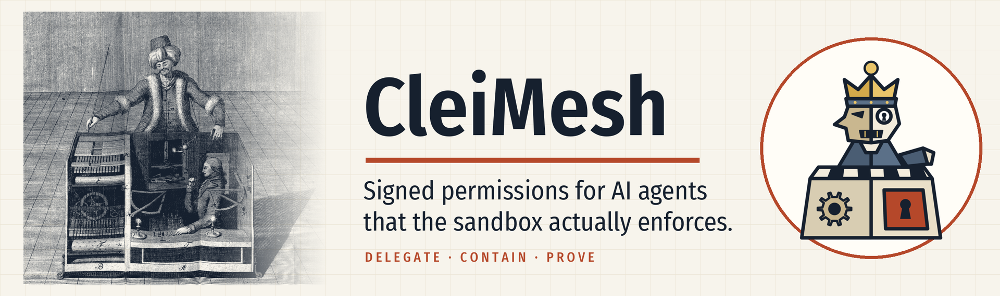
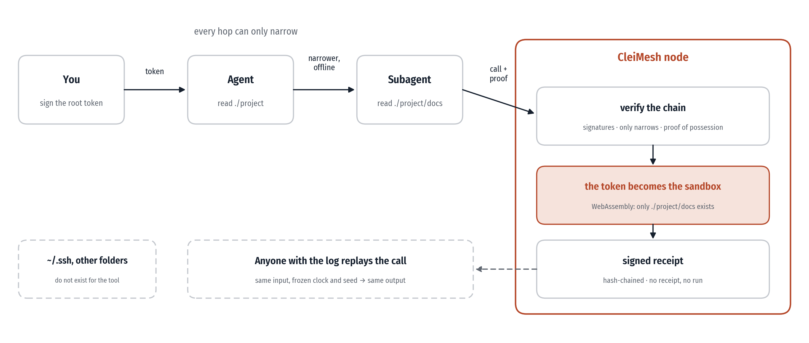
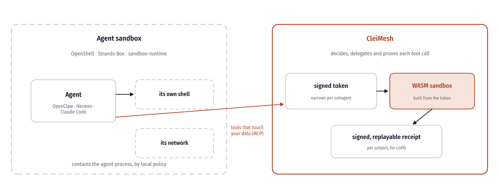
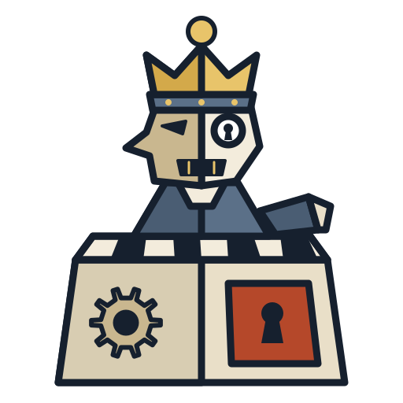
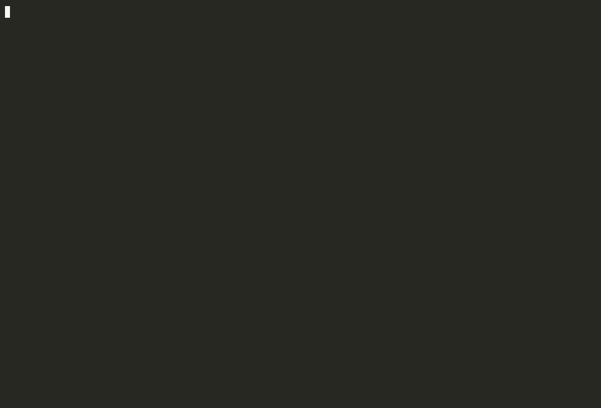
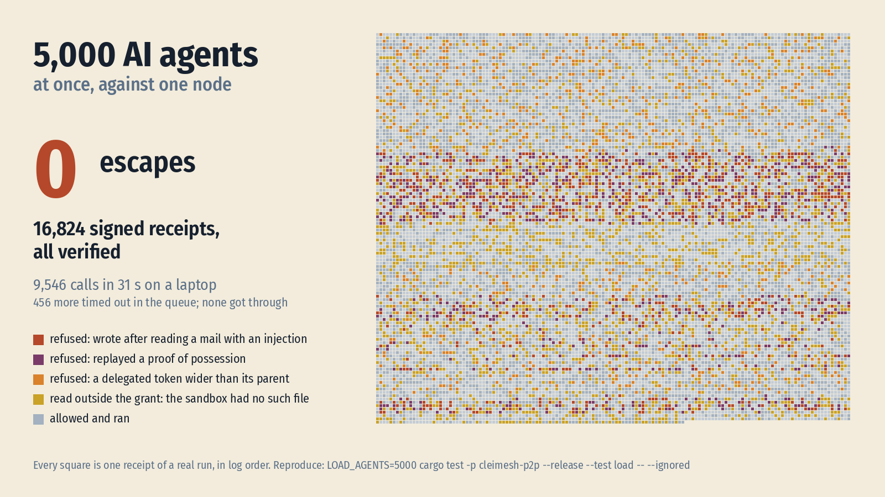
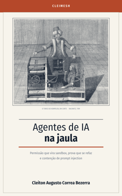

<picture>
  <source media="(prefers-color-scheme: dark)" srcset="docs/assets/banner-dark.png">
  
</picture>

# CleiMesh

[](https://github.com/cleitonaugusto/cleimesh/actions/workflows/ci.yml)
[](#licença)

> **Permissões assinadas para agentes de IA que o sandbox realmente aplica, e recibos que qualquer um pode reexecutar para conferir.**

*[Read in English](README.md)*


<p align="center">
  <a href="https://leanpub.com/agentes-de-ia-na-jaula"></a>
  <br>
  <b>Por que ele é construído assim, os ataques que ele barra e os erros do caminho.</b>
</p>

Agentes de IA (Claude Code, Cursor, LangGraph, CrewAI...) chamam tools de terceiros e delegam tarefas a outros agentes, quase sempre **com todas as suas permissões**. Uma tool maliciosa, ou uma prompt injection escondida num e-mail que o agente leu, pode ler `~/.ssh` e `.env`, apagar arquivos ou vazar dados. E depois ninguém consegue provar qual agente fez o quê, em nome de quem.

A maioria das ferramentas da área checa a permissão **na porta** (um proxy ou gateway) e depois deixa a tool rodar com acesso total, e os logs de auditoria pedem que você confie em quem os assinou. O CleiMesh junta cinco peças:

1. **Permissão assinada e delegável.** Você concede um token a um agente; ele pode repassar uma parte menor a um subagente, offline, e nunca mais do que recebeu. Os tokens seguem o perfil JWT do draft IETF [Attenuating Agent Tokens](https://datatracker.ietf.org/doc/draft-niyikiza-oauth-attenuating-agent-tokens/).
2. **A permissão vira o sandbox.** As tools rodam em WebAssembly, onde **nada é permitido por padrão**. O token decide quais pastas a tool enxerga, se ela tem rede e quais são os limites. Um subagente com `./projeto/docs` não consegue, fisicamente, ler `./projeto`, mesmo que o pai consiga.
3. **Recibo assinado de cada chamada**, aceita ou recusada, encadeado por hash, com cabeça do log assinada, verificável offline, no formato do [draft-sahu-agent-action-receipts](https://datatracker.ietf.org/doc/draft-sahu-agent-action-receipts/). O recibo guarda hashes e pseudônimos, nunca os dados que a chamada tocou. Sem recibo, sem execução.
4. **Não confie no recibo: reexecute.** Toda chamada roda com relógio congelado e aleatoriedade com semente, gravados no recibo, então um auditor reexecuta e confere a saída byte a byte. Um nó que assina um resultado falso é pego. Só um sandbox determinístico consegue oferecer isso; um proxy cujas tools rodam nativas não consegue.
5. **Contaminação que segue a cadeia de delegação, contra prompt injection.** Depois que uma tool que traz conteúdo de fora (e-mail, web) responde a um agente, as tools que agem no mundo recusam a cadeia inteira desse agente até um humano liberar. Quem aplica é o nó, fora do agente: o agente não consegue forjar nem apagar a contaminação, e delegar a um subagente novo não a lava.

<picture>
  <source media="(prefers-color-scheme: dark)" srcset="docs/assets/how-it-works-dark.png">
  
</picture>

Em cima disso, tokens que encolhem para o que o agente de fato usou (`audit suggest`) e relatórios em português para a LGPD, por titular de dados e por agente.

### Onde ele se encaixa

<picture>
  <source media="(prefers-color-scheme: dark)" srcset="docs/assets/where-it-fits-dark.png">
  
</picture>

Sandboxes de agente como o NVIDIA OpenShell, o AWS Strands Box e o sandbox-runtime da Anthropic contêm **o processo do agente**: arquivos, chamadas de sistema e rede, por uma política local. O CleiMesh trabalha um nível abaixo, em **cada chamada de ferramenta**: o que esta ferramenta, chamada por este agente ou subagente, pode tocar, decidido por um token assinado que só diminui ao ser delegado, e provado depois por um recibo assinado que qualquer um reexecuta. Um completa o outro: rode o agente dentro de um desses sandboxes para conter o que ele faz fora do CleiMesh (o shell dele, as outras ferramentas), e passe pelo CleiMesh as ferramentas que tocam os seus dados.

Dentro de um sandbox desses, a máquina do nó costuma ter nome em vez de IP; `--node` e `--bootstrap` aceitam `/dns4/HOST/tcp/PORTA/p2p/PEER_ID`. Passo a passo com o NVIDIA OpenShell, testado: [docs/openshell.md](docs/openshell.md) (em inglês).

| | Sandboxes de agente (OpenShell, Strands Box, sandbox-runtime) | CleiMesh |
|---|---|---|
| O que fica contido | o processo inteiro do agente | cada chamada de ferramenta |
| De onde vem a permissão | um arquivo de política ou um gateway central | um token assinado, do qual o sandbox é montado |
| Subagentes | dividem a política do agente | recebem um token menor, offline, nunca maior |
| Depois | logs de decisão | recibos assinados e encadeados, reexecutáveis byte a byte |
| Prompt injection | regras sobre os eventos da sessão (Strands Box) | contaminação de todos os portadores da cadeia de delegação, liberada só por humano |

*(Situação em outubro de 2026; confira em cada projeto o que ele faz hoje.)*

> ⚠️ **Alpha, em desenvolvimento ativo.** Não use ainda para proteger nada importante. O que ele protege, o que não protege e as lacunas antes da 1.0 estão no [threat model](docs/threat-model.md).

## Veja funcionando



```sh
cargo build -p cleimesh-cli
CLEIMESH=target/debug/cleimesh examples/demo/demo.sh
```

A demo acima roda em uns 15 segundos (a gravação pausa para dar tempo de ler), inteira dentro de uma pasta nova em `/tmp`, com um projeto falso, uma `~/.ssh` falsa, uma caixa de e-mail falsa e chaves descartáveis. Os quatro atos (contenção, prompt injection, prova, o humano decide) também saem como clipes curtos. Veja [`examples/demo`](examples/demo/README.md).

### Pelo Claude Code (MCP)

O Claude Code roda comandos no shell como o seu usuário, então o nó precisa rodar como outro, senão o agente conseguiria ler a chave do nó e tirar as próprias restrições. Configuração única: [docs/separate-user.md](docs/separate-user.md) (um usuário `cleimesh` e um serviço do systemd).

```sh
# Como o usuário do nó, a chave dele assina um token que dá ao seu agente leitura de um projeto
cd / && sudo -u cleimesh cleimesh token issue $(cleimesh id --client) --tool file_read --read ~/code/meu-projeto -o /var/lib/cleimesh/cadeia.json
sudo cat /var/lib/cleimesh/cadeia.json > ~/cadeia.json

# O mcp serve só encaminha cada tools/call, com esse token, ao nó; o nó roda no sandbox e guarda os recibos
claude mcp add cleimesh -- cleimesh mcp serve --node /ip4/127.0.0.1/tcp/7400/p2p/<NODE_ID> --token ~/cadeia.json

# O que aconteceu, e a prova de que o log não foi editado nem cortado
sudo -u cleimesh cleimesh audit tail
sudo -u cleimesh cleimesh audit verify
```

Para experimentar sem a configuração, tire o `--node` e o `sudo -u cleimesh`: o nó roda dentro do `mcp serve`, como o seu usuário, e avisa ao iniciar que essa proteção está desligada.

### Pelo OpenClaw, Hermes Agent e outros clientes MCP

Qualquer agente que fale MCP por stdio usa o mesmo comando `mcp serve`. Mesmo nó e mesmo token de cima; use caminhos absolutos.

```sh
# OpenClaw
openclaw mcp add cleimesh --command cleimesh --arg mcp --arg serve \
  --arg --node --arg /ip4/127.0.0.1/tcp/7400/p2p/<NODE_ID> --arg --token --arg /home/voce/chain.json
openclaw mcp doctor cleimesh --probe
```

```json5
// ~/.openclaw/openclaw.json: só as ferramentas do CleiMesh, nenhuma ferramenta própria de arquivo ou shell do OpenClaw
"tools": { "profile": "minimal", "alsoAllow": ["bundle-mcp", "cleimesh__*"],
           "deny": ["read", "write", "edit", "apply_patch", "exec", "process", "ls"] }
```

```yaml
# Hermes Agent: ~/.hermes/config.yaml
mcp_servers:
  cleimesh:
    command: "cleimesh"
    args: ["mcp", "serve", "--node", "/ip4/127.0.0.1/tcp/7400/p2p/<NODE_ID>", "--token", "/home/voce/chain.json"]
```

Testado em containers descartáveis com um modelo roteirizado no lugar de um LLM ([`tests/agents`](tests/agents), toda semana no CI): um turno completo do OpenClaw 2026.10.3 e do Hermes Agent v0.22 grava um rascunho, lê um e-mail com injeção e tem a gravação seguinte recusada pelo nó, com a recusa num recibo assinado. Com um modelo local de verdade (Qwen3 4B no Ollama) e o OpenClaw configurado como acima, o agente leu o e-mail pelo CleiMesh e a gravação foi recusada; com as ferramentas de arquivo do próprio OpenClaw ligadas, a mesma injeção gravou o arquivo sem nunca chamar o CleiMesh. O CleiMesh só contém as ferramentas que passam por ele: um agente que mantém o próprio shell ou ferramentas de arquivo ainda pode usá-los, então desligue essas ferramentas, filtre-as (a política de ferramentas do OpenClaw, o `tools` por servidor do Hermes) ou rode o agente dentro de um sandbox (veja [Onde ele se encaixa](#onde-ele-se-encaixa)).



*Um modelo local de verdade, um e-mail envenenado, dois atos: [examples/demo-real-model](examples/demo-real-model/README.md) (em inglês).*

### Pôr um servidor MCP existente atrás de um token

```sh
# O servidor fetch como único caminho do agente para a web, contaminando o que ele traz
cleimesh token issue <agente> --tool fetch --taints -o fetch.json
claude mcp add fetch -- cleimesh mcp wrap --token fetch.json -- uvx mcp-server-fetch
```

O `mcp wrap` mostra ao agente só as ferramentas do servidor que o token concede, confere cada chamada contra as restrições de argumento e a contaminação do token, e grava um recibo assinado antes de repassá-la. **O servidor embrulhado não roda em sandbox**: ele roda nativo e alcança o que o usuário do sistema dele alcança, então um token que concede pastas ou rede a ele é recusado, em vez de registrado como se valesse, e as chamadas dele não reexecutam. Para contenção, a ferramenta precisa rodar no sandbox WASM, ou o servidor dentro de um sandbox de agente.

### Conter prompt injection

```sh
# Ler a caixa de entrada traz conteúdo de fora; escrever na caixa de saída age no mundo
cleimesh token issue <agente> --tool file_read --read ~/entrada --taints -o leitura.json
cleimesh token issue <agente> --tool file_write --write ~/saida --clean-only -o escrita.json

# Depois que o agente lê um e-mail, file_write é recusado para a cadeia inteira dele:
#   file_write refused: holder … in this chain received untrusted content (receipt …)
cleimesh taint list
cleimesh taint clear <peer-id-do-agente> --motivo "e-mail revisado"   # decisão humana, registrada em recibo
```

## Documentação

| | |
|---|---|
| [Guia de uso](docs/uso.md) | delegar, reexecutar, encolher o token, auditoria e retenção, flags de token, escrever uma tool |
| [NVIDIA OpenShell](docs/openshell.md) | o agente num sandbox do OpenShell e o CleiMesh fora dele, testado (em inglês) |
| [Usuário separado](docs/separate-user.md) | o nó como usuário próprio do sistema, fora do alcance do agente (em inglês) |
| [Threat model](docs/threat-model.md) | o que é protegido, o que não é, e o teste de cada afirmação (em inglês) |
| [Os Dez Mandamentos](docs/mandamentos.md) | os princípios, cada um com os testes que o garantem |
| [Benchmarks](docs/benchmarks.md) | custo por chamada, reproduzível com `scripts/bench.sh` (em inglês) |

## O que funciona hoje

| Parte | Estado |
|---|---|
| Sandbox WASM (wasmtime): sem arquivos e sem rede por padrão; limites de tempo, instruções e memória | ✅ testado |
| Cadeias AAT: emitir, derivar offline, verificar (assinaturas, atenuação, prova de posse, anti-replay) | ✅ testado, com testes de propriedade e fuzzing |
| Token → sandbox: pastas, rede e limites por tool, restritos a cada elo, à prova de symlink | ✅ testado |
| Recibos assinados e encadeados; fail-closed; cabeça do log assinada; retenção com recibo da eliminação | ✅ passa nos vetores oficiais do draft de recibos |
| Recibos reexecutáveis (`audit replay`): relógio congelado, aleatoriedade com semente | ✅ testado, inclusive pegando um nó que assina um resultado falso |
| Contaminação pela cadeia de delegação (`--taints`, `--clean-only`, `taint clear`) | ✅ testado: não se lava delegando nem trocando de token |
| Relatório LGPD por titular (pseudônimo com chave) e por agente (`audit report`) | ✅ falta revisão jurídica do texto |
| `cleimesh mcp serve` (stdio, SDK oficial `rmcp`) | ✅ testado com cliente MCP real e com o Claude Code (headless), inclusive com um e-mail com prompt injection |
| Chamadas remotas entre nós (libp2p) com token | ✅ testado |
| Permissão que encolhe sozinha: o sandbox registra quais pastas a chamada tocou (por pseudônimo com chave) e `audit suggest` propõe o token menor | ✅ testado |
| Quarentena para conteúdo não confiável | 📋 planejado (C6) |
| Storage RAG, multi-tenancy, adapters, API HTTP/gRPC | 🧊 congelados até o núcleo ficar sólido |

### Custo

Preliminar, num desktop em uso (i7-10750H); reproduza com [`scripts/bench.sh`](scripts/bench.sh), tabela completa em [`docs/benchmarks.md`](docs/benchmarks.md):

| | Mediana |
|---|---|
| `echo` no sandbox puro | 0,46 ms |
| `echo` com cadeia de 2 tokens, permissões de sandbox e 2 recibos com fsync | 3,27 ms |
| Verificar cadeia de 1 / 16 tokens | 98 µs / 1,06 ms |
| Referência: um container Docker por chamada | ~320 ms |

A maior parte do custo da aplicação são os dois fsync dos recibos.

### Sob carga

<picture>
  <source media="(prefers-color-scheme: dark)" srcset="docs/assets/load-dark.png">
  
</picture>

5.000 agentes simulados ao mesmo tempo, um sexto em cada papel: leitores e escritores honestos, e agentes que leem fora da permissão, gravam depois de ler um e-mail com injeção, reaproveitam uma prova ou ampliam o token. Nada passou, e o log verifica com exatamente os recibos que as chamadas implicam ([`cleimesh-p2p/tests/load.rs`](cleimesh-p2p/tests/load.rs)). Um nó aguenta cerca de 400 chamadas por segundo num notebook, com dois recibos gravados em disco por chamada; acima disso a fila cresce e as últimas chamadas expiram sem rodar.

## O que ele não faz

- Não faz o agente *querer* a coisa certa. Ele limita o que a tool alcança e prova o que aconteceu.
- Uma ação permitida pelo token ainda pode ser a ação errada (um e-mail permitido com o conteúdo errado). Aprovação humana para ações de risco está no plano.
- Só isola tools que rodam no sandbox dele. Servidores MCP nativos atrás do `mcp wrap` passam pelo token e deixam recibo, mas não ficam isolados; o resto, nem isso.
- A contaminação aproxima "o agente leu conteúdo não confiável" por "o nó devolveu a saída de uma tool `--taints` a essa cadeia": conteúdo que chega ao agente por outro caminho não contamina. É grossa de propósito: depois de ler um e-mail, o agente perde as tools `--clean-only` até um humano liberar. A política vale o que valem os rótulos das tools.
- A aleatoriedade dentro do sandbox tem semente, e a semente está no recibo: uma tool não deve gerar segredos lá dentro. Chamadas que leem pastas ou usam rede ainda não reexecutam; a entrada da chamada fica com o controlador dos dados, não no recibo.
- Quem tem acesso ao disco poderia voltar o log e a cabeça juntos; guarde uma cabeça em outro lugar (`audit head`) e confira com `audit verify --head`.
- A contaminação é por nó: o mesmo token usado em dois nós é contaminado separadamente.

A lista completa, com o que sustenta cada proteção e o teste que a confere, está no [threat model](docs/threat-model.md) (em inglês).

Os princípios por trás disso, cada um com os testes que o garantem: [Os Dez Mandamentos do Agente Sob Controle](docs/mandamentos.md).

## O livro

[](https://leanpub.com/agentes-de-ia-na-jaula)

Este README diz o que o CleiMesh faz. O livro diz **por quê**: como agentes acabam com todas as suas permissões, como a prompt injection passa pelos filtros, por que a permissão deve virar o sandbox em vez de uma checagem na porta, o que um recibo assinado prova e o que não prova, o agente com shell que podia se absolver, e como o projeto foi construído e corrigido, com os erros. O capítulo 10 leva a LGPD à prática, com relatório por titular e permissão mínima a partir dos recibos.

Cada comando do livro roda contra o binário `cleimesh` antes de cada edição, e a geração falha se algum deixar de fazer o que o texto diz.

- **[Agentes de IA na jaula](https://leanpub.com/agentes-de-ia-na-jaula)** (português)
- **[AI Agents in a Cage](https://leanpub.com/ai-agents-in-a-cage)** (inglês)

Os dois primeiros capítulos são uma amostra grátis. Não há editora por trás; se ele te ajudar, uma avaliação honesta faz muita diferença.

## Desenvolvimento

```sh
cargo build --workspace --all-targets && cargo test --workspace
scripts/bench.sh     # benchmarks -> docs/benchmarks.md
scripts/fuzz.sh      # fuzzing (nightly + cargo-fuzz)
```

Veja [`CONTRIBUTING.md`](CONTRIBUTING.md). Problemas de segurança: [`SECURITY.md`](SECURITY.md).

## Licença

À sua escolha, [Apache License, Version 2.0](LICENSE-APACHE) ou [licença MIT](LICENSE-MIT).
