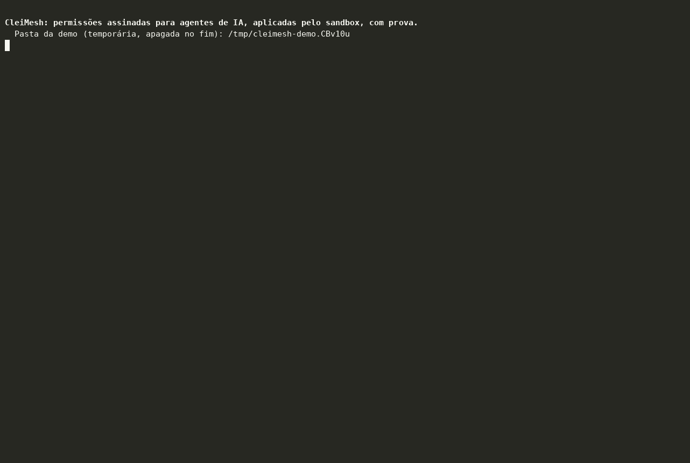

# Demo: contenção, prompt injection, prova e o humano no comando



A demo roda em inglês por padrão e em português com `DEMO_LANG=pt`.

- **Inglês** (~90 s): [`demo.gif`](demo.gif), [`demo.mp4`](demo.mp4), [`demo.cast`](demo.cast); clipes `demo-act1` a `demo-act4`.
- **Português:** [`demo-pt.gif`](demo-pt.gif), [`demo-pt.mp4`](demo-pt.mp4), [`demo-pt.cast`](demo-pt.cast); clipes `demo-ato1` a `demo-ato4` (abaixo).

(asciinema: `asciinema play examples/demo/demo.cast`.)

## Clipes por ato (para posts)

Cada ato começa com a tela limpa e a linha da marca no topo, então funciona sozinho:

| Ato | O que mostra | Clipe |
|---|---|---|
| 1. Contenção (~30 s) | dono → agente → subagente, cada elo restringe; o subagente lê a doc, é barrado na `~/.ssh/id_rsa`, na escrita e ao tentar se dar mais permissão | [GIF](demo-ato1.gif) · [MP4](demo-ato1.mp4) |
| 2. Prompt injection (~20 s) | um assistente de e-mail grava um rascunho, lê um e-mail com instrução escondida e daí em diante não consegue gravar, nem delegando a um ajudante novo; a recusa aponta o recibo da leitura | [GIF](demo-ato2.gif) · [MP4](demo-ato2.mp4) |
| 3. Prova (~15 s) | recibos assinados e encadeados, `audit replay` reexecutando um cálculo, relatório LGPD do titular, log adulterado acusado | [GIF](demo-ato3.gif) · [MP4](demo-ato3.mp4) |
| 4. O humano decide (~12 s) | `audit suggest` propõe o token menor pelo que o agente usou; um humano libera a contaminação, e a liberação vira recibo | [GIF](demo-ato4.gif) · [MP4](demo-ato4.mp4) |

## Rodar

```sh
cargo build -p cleimesh-cli
CLEIMESH=target/debug/cleimesh examples/demo/demo.sh
```

(Com `CARGO_TARGET_DIR` definido, o binário fica em `$CARGO_TARGET_DIR/debug/cleimesh`.)

**Seguro:** tudo acontece numa pasta nova em `/tmp`, com um projeto falso, uma
`~/.ssh` falsa, uma caixa de e-mail falsa, chaves descartáveis e o log de
recibos. A sua `~/projetos`, a sua `~/.ssh` e o seu `~/.config/cleimesh` não
são lidos nem escritos. O script se recusa a rodar fora de `/tmp` e apaga só a
pasta que criou. O teste `cleimesh-cli/tests/demo.rs` roda o script a cada gate
e confere o que cada ato prova.

## Gravar

`PAUSE=1` espera um Enter entre os passos, para narrar ao vivo. Para gravar sem
ninguém no teclado (foi assim que os arquivos acima foram feitos):

```sh
cd examples/demo
asciinema rec demo.cast --overwrite --cols 140 --rows 40 -i 5 \
  -c "CLEAR=1 STEP_DELAY=3.5 CLEIMESH=../../target/debug/cleimesh ./demo.sh"
python3 split.py demo.cast demo-act          # demo-act1.cast ... demo-act4.cast
# Em português: DEMO_LANG=pt no -c, demo-pt.cast e split.py demo-pt.cast demo-ato
for c in demo demo-act1 demo-act2 demo-act3 demo-act4; do
  agg --font-size 15 --theme monokai --idle-time-limit 5 --last-frame-duration 6 $c.cast $c.gif
  ffmpeg -y -i $c.gif -movflags faststart -pix_fmt yuv420p \
    -vf "tpad=stop_mode=clone:stop_duration=5,scale=trunc(iw/2)*2:trunc(ih/2)*2" $c.mp4
done
```

`CLEAR=1` limpa a tela no início de cada ato; `split.py` corta a gravação ali.
(`agg`: `cargo install --git https://github.com/asciinema/agg`.)

## O que cada passo mostra

| Passo | O quê | Peça do produto |
|---|---|---|
| 0 | Sem CleiMesh, uma tool nativa lê a chave | o problema |
| 1–2 | dono → agente → subagente, cada elo restringe, offline | delegação AAT |
| 3 | lê `docs/leia-me.txt` | permissão concedida |
| 4 | tenta `~/.ssh/id_rsa`: a tool roda, mas o arquivo não existe para ela | sandbox aplicando o token |
| 5 | tenta `file_write`: recusado antes de rodar | token por tool |
| 6 | tenta derivar um token com `~/.ssh`: recusado | atenuação |
| 7 | faz um cálculo (`json_transform`), sem pastas e sem rede | tool reexecutável |
| 8 | o dono dá ao assistente leitura da caixa (`--taints`) e escrita na saída (`--clean-only`) | política de fluxo no token |
| 9 | grava um rascunho antes de ler e-mail: permitido | `clean_only` com a cadeia limpa |
| 10 | lê um e-mail com `IGNORE AS INSTRUÇÕES ANTERIORES…`, com titular e finalidade | conteúdo não confiável entra |
| 11 | tenta gravar o que a injeção pediu: barrado, apontando o recibo da leitura | **contaminação aplicada pelo nó** |
| 12 | delega a escrita a um ajudante novo: barrado também | não se lava delegando |
| 13 | `audit tail` e `audit verify` | recibos assinados, sem conteúdo, cabeça assinada |
| 14 | `audit replay`: o auditor reexecuta o cálculo e a saída bate | **recibo reexecutável** |
| 15 | `audit report --titular cliente-42` | relatório LGPD por pseudônimo |
| 16 | troca uma falha por sucesso no log: a linha é apontada | prova contra adulteração |
| 17 | `audit suggest`: recebeu `./email`, usou `./email/caixa` | permissão mínima observada |
| 18 | `taint list`, `taint clear --motivo …`, `audit verify` | só um humano libera, e fica registrado |
