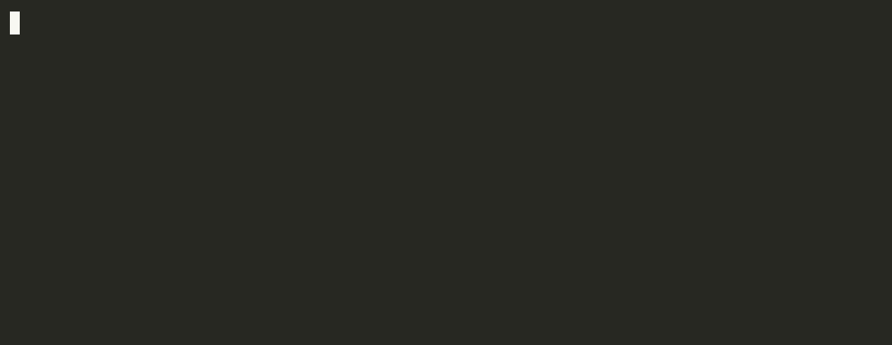

# Guard a coding agent: Claude Code

Your coding agent reads a GitHub issue, a web page or a downloaded file with an instruction hidden in it, and three steps later it runs `curl -d @.env …` or `git push` to somewhere new. A rule that judges each command on its own has to guess, because the command that leaks doesn't look like the read that caused it. `cleimesh guard` remembers the read.

```sh
cleimesh guard install            # every project; or: --project <dir>
```



It adds one `PreToolUse` hook to Claude Code's settings (`~/.claude/settings.json`, or `<dir>/.claude/settings.json`), keeping what is already there. Sessions started from then on are guarded.

## What it does

Each tool call goes through `cleimesh guard hook` first. Once a session brings in **outside content**:

| Outside content (taints the session) |
|---|
| `WebFetch`, `WebSearch` |
| A shell command that reaches the network: `curl`, `wget`, `gh`, `ssh`, `scp`, `rsync`, `nc`…, any URL, `git clone/pull/fetch` |
| Reading a file outside the project (or the `trusted_paths` you list) |
| An MCP tool (`mcp__…`) |

until a person clears it, the session:

- runs only **listed shell commands with plain words**: local build, test and read-only git by default (`cargo test`, `npm test`, `pytest`, `go test`, `make`, `git status/diff/log/show/ls-files/rev-parse/blame/add/commit`, `ls`, `pwd`; not `find`, whose `-exec` runs anything). No pipes, lists, substitution, redirection or variables: those are how one allowed program becomes another;
- reads **no secrets** (`~/.ssh`, `~/.aws`, `.env*`, `*.pem`, `*.key`, `id_*`, `.netrc`, `.npmrc`, credentials…);
- writes **nothing outside the project**, and nothing that outlives the session: `CLAUDE.md`, `AGENTS.md`, `.claude/`, `~/.claude/` (memory, settings, hooks), `.git/hooks`, shell rc files;
- calls **no MCP tool** that isn't listed as read-only;
- fetches **no URL with a query or fragment** (the URL itself can carry data out).

A session that read nothing from outside works as before. Another session, started clean, is not affected. Subagents share their session's state.

The agent sees why, and how to undo it:

```text
cleimesh guard: shell operators (pipes, lists, substitution, redirection, variables) after this session
brought in outside content (receipt 019a…). A person clears it: cleimesh guard clear 6f1c…
```

```sh
cleimesh guard status                                   # tainted sessions and the receipt that did it
cleimesh guard clear <session> --reason "read the issue myself; nothing in it"
```

Clearing is recorded as a receipt with the reason.

## The record

Every decision, allowed or refused, is a signed, hash-chained receipt in `<data dir>/cleimesh/receipts/claude-code.jsonl` (on Linux, `~/.local/share/cleimesh/receipts/`), with the tool, a digest of its input, and for a refusal the receipt of the read that caused it.

```sh
cleimesh audit verify --receipts ~/.local/share/cleimesh/receipts/claude-code.jsonl
cleimesh audit view   --receipts ~/.local/share/cleimesh/receipts/claude-code.jsonl   # writes cleimesh-audit.html
```

## Your settings

`~/.config/cleimesh/guard/claude-code.json` (optional):

```json
{
  "allow_when_tainted": ["cargo bench", "npm run lint"],
  "mcp_read_only": ["mcp__github__get_*", "mcp__docs__search"],
  "trusted_paths": ["/home/me/src/shared-lib"]
}
```

## Limits, stated plainly

- **A hook is a policy check, not isolation.** A command the guard lets run runs with your rights. `npm run`, `make` and `cargo test` run what the project defines: if the project itself is hostile, the guard is the wrong tool; CleiMesh's sandbox is.
- **Network reads by shell are recognized by name** (the programs above, any `://`). A command that reaches the network another way doesn't taint the session. Tainting is the safe direction to be wrong in; add programs you use.
- **Data can leave through what stays allowed.** A fetch without a query string still names a host and a path. The guard keeps secrets out of a tainted session so there is less to carry.
- **It fails closed.** If the hook can't decide (unreadable input, a receipt it can't write), the call is refused. Claude Code otherwise lets a call through when a hook fails, so the hook is installed with `onFailure: "block"` too.
- **Claude Code's own permissions still apply.** The guard never answers "allow"; it refuses or stays out of the way.
- Tested with the hook input Claude Code documents for `PreToolUse`. Cursor and Codex have similar hooks; not supported yet.
